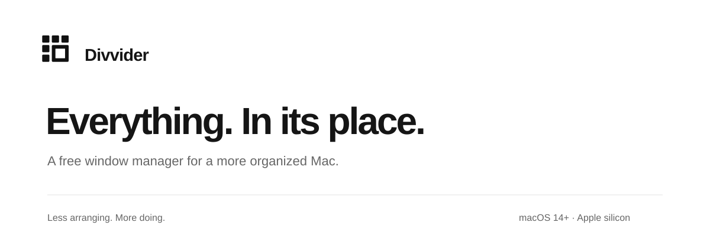
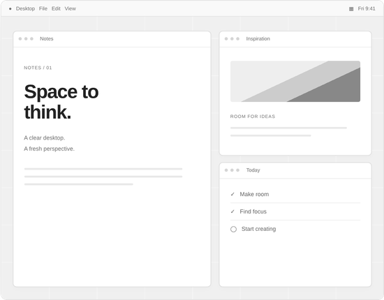

[Download for Mac](#) · [Website](https://divvider.app) · [Getting started](#getting-started) · [Updates](#updates)

Divvider is a free window manager for Mac. Open a simple grid, choose a space, and release to move and resize your window. Less arranging. More doing.

**macOS 14 or later · Apple silicon · Free**

**Initial public release planned as v0.9.0. The app and downloads are not yet published.**

*Illustrated desktop. Each placement moves one focused window.*

## A little order, in three moves

1. **Open the grid.** Focus a window and press **Control + Option + D**, or click Divvider in your menu bar.
2. **Choose a space.** Drag across the cells to draw the region you want.
3. **Let it fall into place.** Release to move and resize the window. Press **Escape** to cancel.

## Your space, your way

- **A grid that fits.** Choose rows and columns, window gaps and screen margins. Subdivide for finer placements.
- **Favorite moves, fewer keystrokes.** Save placements with global shortcuts or shortcuts that work while the grid is open.
- **Three ways to see it.** Use a fullscreen grid, a compact selector, or both together.
- **At home on your Mac.** A native menu bar app with light and dark appearances, a customizable summon shortcut and optional start at login.

## Getting started

1. [Download Divvider](#), unzip it, and move **Divvider.app** into **Applications**.
2. Open Divvider. Follow its setup guidance to allow window control in **System Settings → Privacy & Security**.
3. Focus a window, press **Control + Option + D**, and drag across the grid. Release to place it.

The window-control permission is called **Accessibility** on earlier macOS versions, or **Device Control and Data Access** on macOS 27 and later.

### Requirements

| Requirement | Details |
| --- | --- |
| Operating system | macOS 14 or later |
| Mac | Apple silicon |
| Permission | Window control through macOS Accessibility |
| Price | Free |

The current build does not support Intel Macs.

## A few useful details

### A window does not fit the selected area

Some apps set a minimum size or limit window resizing. Divvider works within those limits, so the final window may differ from your selection. Exit macOS fullscreen before arranging a window.

### Permission stopped working after an update

Quit Divvider. In its window-control permission pane, remove the old entry, add the copy from **Applications**, enable it, and reopen the app.

### Privacy

Settings and saved placements stay on your Mac. Divvider does not require an account or include analytics. Local diagnostic logs help explain permission and window-placement issues.

## Updates

The planned initial public release is **v0.9.0**. The signed app and downloads are not published yet.

[Download for Mac](#) · [Release notes and earlier versions](#)

The permanent Sparkle feed is planned at `https://divvider.app/updates/appcast.xml`. It will be published only after the signed release ZIP is uploaded and verified.

## Help and feedback

Start with the [website help section](https://divvider.app/#help) or the guidance above. When reporting a problem, include:

- Your macOS and Divvider versions. **Copy App Info** in Divvider’s About tab helps collect the basics.
- The affected app and the steps that led to the issue.
- What you expected and what happened instead.

Leave private window contents out of reports. [GitHub issue tracker](#) — link to be added when the repository is ready.

---

[Divvider website](https://divvider.app) · Everything. In its place.
